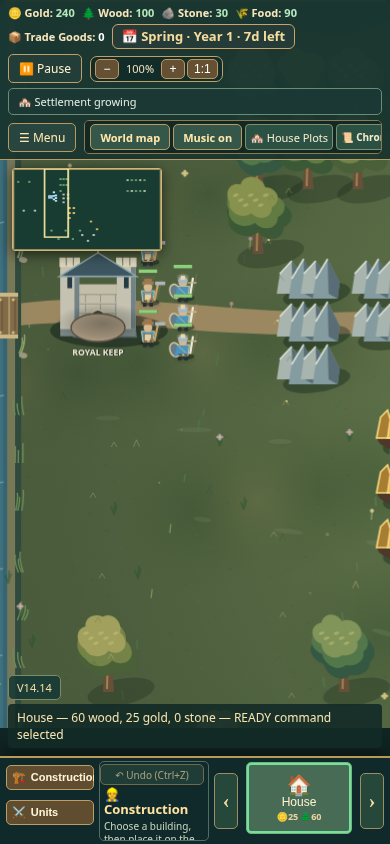
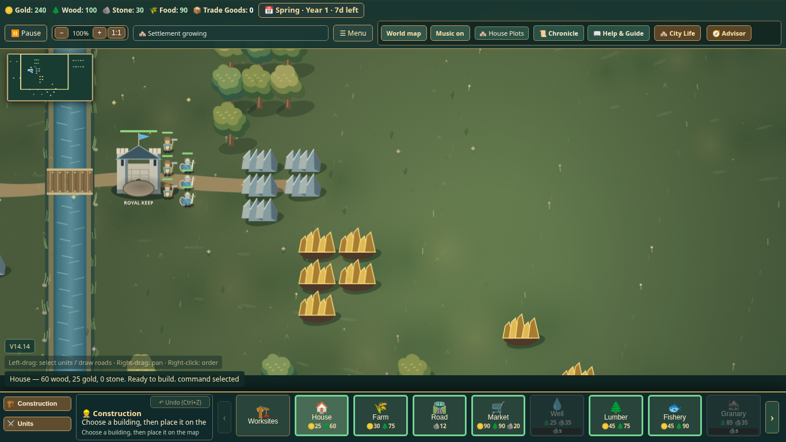

# v0.21 responsive HUD repair

The screenshot-sized 390×844 baseline at 9b5ed5b reproduced Food, Trade Goods and calendar overlap with Pause. The bar wrapped but retained a fixed height, while other controls used independent viewport offsets.

The HUD now uses a shared wrapping flow. Its measured height supplies minimap and panel clearance. Notifications stack above the command bar, dismissed messages leave the flow, and overflowing notices can scroll.

## Evidence

- Six viewport cases: 320×740, 390×844, 430×932, 844×390, 1366×768 and 1920×1080.
- The six HUD tests passed locally, including native Pause, Menu, Help/Chronicle opening and close-button hit targets, and actual House selection feedback.
- Earlier combined HUD/City Life/v0.21 layout batch: 16/16 passed. Counts overlap.
- Read-only review found no remaining critical or important issue after panel clearance and notice overflow corrections.
- 128 inline scripts parse; git diff --check passes.
- Local full regression and packaged smoke were started; the full run has page-load timeouts and must not be described as clean. Final results and required CI status belong to PR #36's latest checks.
- Local runtime: Node24.19.0, Playwright1.57.0, system Chromium154.0.8037.57. The environment blocked the pinned browser download; GitHub CI uses the pinned browser independently.

Corrected screenshots show actual running gameplay and native House selection, with no grants, injected buildings, replacement art or image compositing:

Game source commit: cc3551fd5c5a63052cc414dbff94dad5eac8469d. This evidence follow-up changes only documentation and screenshots. Merge remains gated on the latest required-ci result and owner decision.
