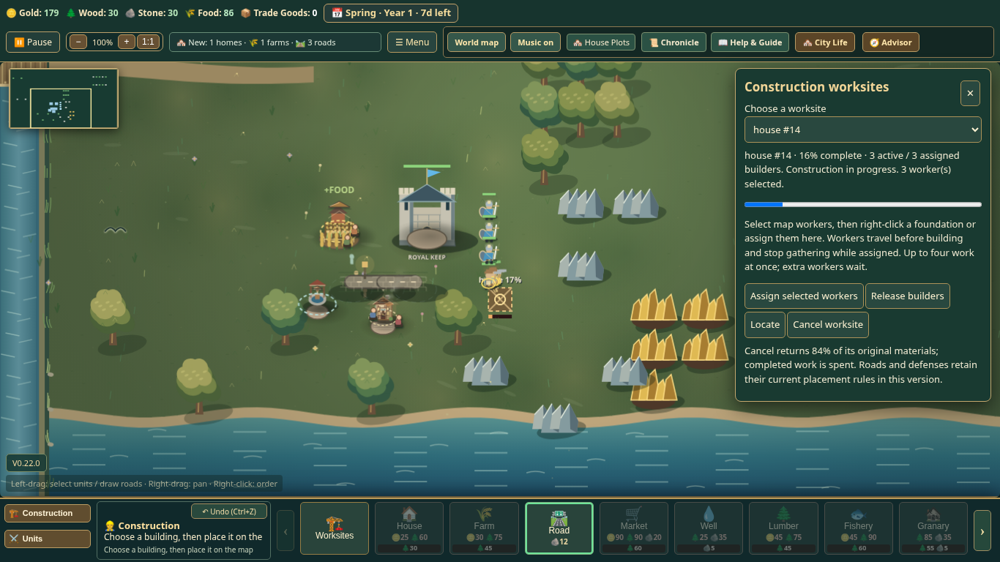
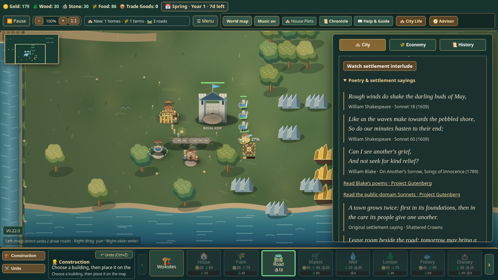
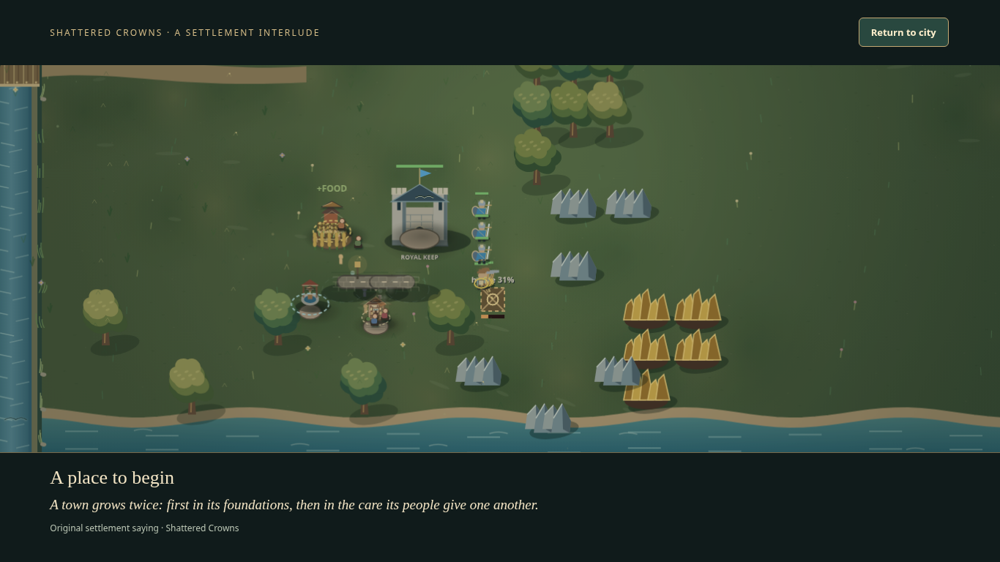

# v0.22 — A Living Settlement verification

11 November 2026. Base: released main `772b191`. Candidate game/release bytes: `ca42a64a2862dc3539be067c7ea383870aea057f`. Draft only; no merge, release dispatch, production deployment, hosting change or spending.

## Scope

Automatic construction follow-up with a four-assigned-builder capacity, preserved manual overrides, less precise resource targeting, game-surface context-menu suppression, mutually exclusive worksite/inspection panels and placement feedback cleanup. Duplicate map-drawn information is removed. Original contact shading, roof highlights and a restrained completion cue accompany optional Chronicle literature and a skippable twelve-second current-city scene. No economy/cost/road/defense/save-schema change. Mobile expansion remains deferred.

## Local evidence

- Before implementation, existing construction/HUD baseline **21/21 passed**.
- Eight initial fail-first cases reproduced missing continuation, overlay context menus, stale notices, duplicate map information and absent literary/scene/audio behavior. A separate near-miss resource regression failed with a move order instead of gathering, then passed with nearest-deposit tolerance.
- Initial presentation checks exposed an existing Chronicle float rule intercepting the new reading control and a first-frame timestamp slightly earlier than scene start. Both were corrected from their failures. A later added F3 regression reproduced changing Pause under the scene; scene keyboard ownership corrected it.
- A broader sequential batch exercised **90 cases: 86 passed, 4 failed**, 933.8 seconds. Three existing construction tests timed out in `page.goto` before assertions: “Sites block repeat placement; release and gather interrupt work without phantom progress”, “Right-click assigns selected map workers to the actual foundation”, and “Pending project saves preserve brookstead identity”. Their retained traces have no uncaught game JavaScript error. This is **not a clean 90/90 claim**.
- The fourth failure was a newly added real scene replay regression: a queued close event from an earlier session closed a newly opened scene. The close handler now checks current dialog state.
- Final sequential focused recheck: **13/13 passed**, 66.3 seconds, original assertions/timeouts retained. It includes those three existing cases plus all ten new feature cases: continuation and exact save roundtrip; capacity/release/cancellation; context menus; selection/Escape cleanup; panel exclusivity and absence of duplicate Canvas text; literature/native scene controls and F3 protection; scene replay/reduced motion/restore/restart; muted/coalesced completion audio; forgiving native resource click; and a real manual gathering order surviving former-project completion.
- **22/22 pipeline unit tests passed**. All 129 inline scripts parse and `git diff --check` passes at the final check.

Local runtime: Node24.19.0, Playwright1.57.0, explicit system Chromium154.0.8037.57. Standard pinned Chromium CI is a separate full-suite gate. Local source/trace evidence is under `work/v022` and `test-results`; the final PR's CI artifacts are the shareable full-suite evidence. Do not infer a clean full local suite from overlapping focused batches or unchanged rechecks.

## Package

Exact committed-source build, allowlist/digest verification and Git source verification passed. Candidate metadata version is `0.22.0`:

- Game SHA256: `85a439eca0037eae982c4bc25d3bd2b79f24fcd44080fa815634a618406aaf62`.
- Release metadata SHA256: `16f92aba6169c26dde0bff5da93c074e1c8da9ca2f92e317322bd2101f728648`.
- Exact-source packaged smoke: **5/5 passed**, zero failures/skips/cancellations, 92.3 seconds. Local verificationRunId0 is not publication approval.

## Review and actual visuals

Independent read-only source review found no Critical/Important/Minor defect and independently verified all three historical excerpts against the documented public-domain source mirrors. Its manual-order coverage request was implemented with a native right-click gathering regression. Later scene replay findings were reproduced and corrected through the tests above.

The final style uses an explicit scene-only body class, not a document-wide relational selector. It hides the legacy Pause overlay only for the scene without changing Pause itself. The authoritative visible version label was corrected from old V14.14 to match release metadata; native preview checks title and badge after normal city entry.

The screenshots show normal Brookstead entry, native worker selection and a house paid for with starting resources. No grants, injected buildings, replacement art, CSS overrides or image compositing. The preview records three assigned/active builders and an actual unfinished house; scenes suspend that same running city.

Source notes: [literature](../LITERARY_SOURCES.md), [scope](../MILESTONE22.md). Device listening, physical devices and other browser engines remain outside these automated desktop checks. Full final-head CI must be green before merge is recommended.
