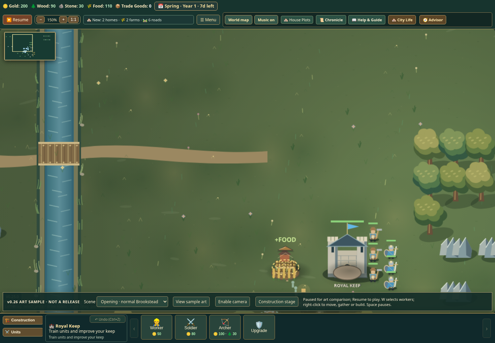
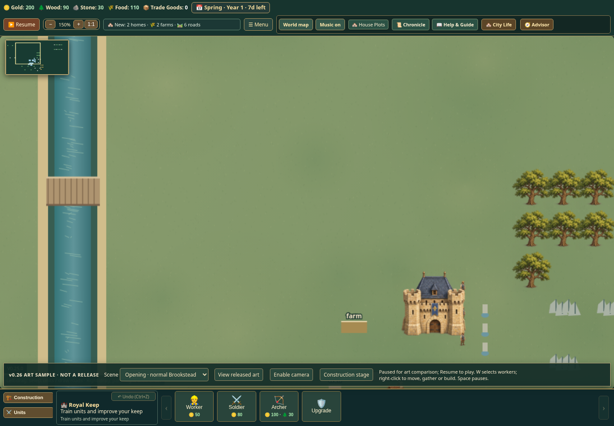
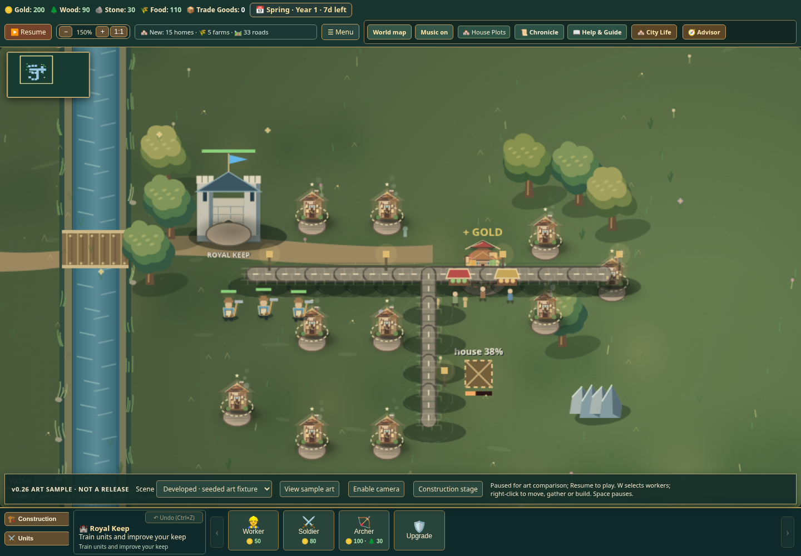
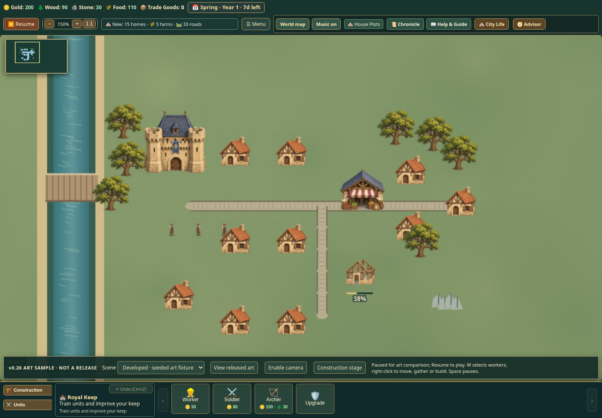
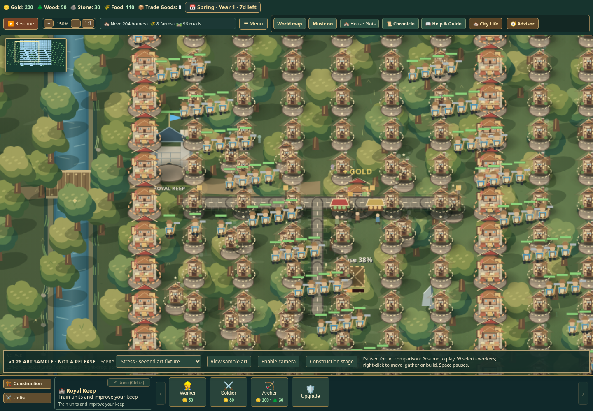
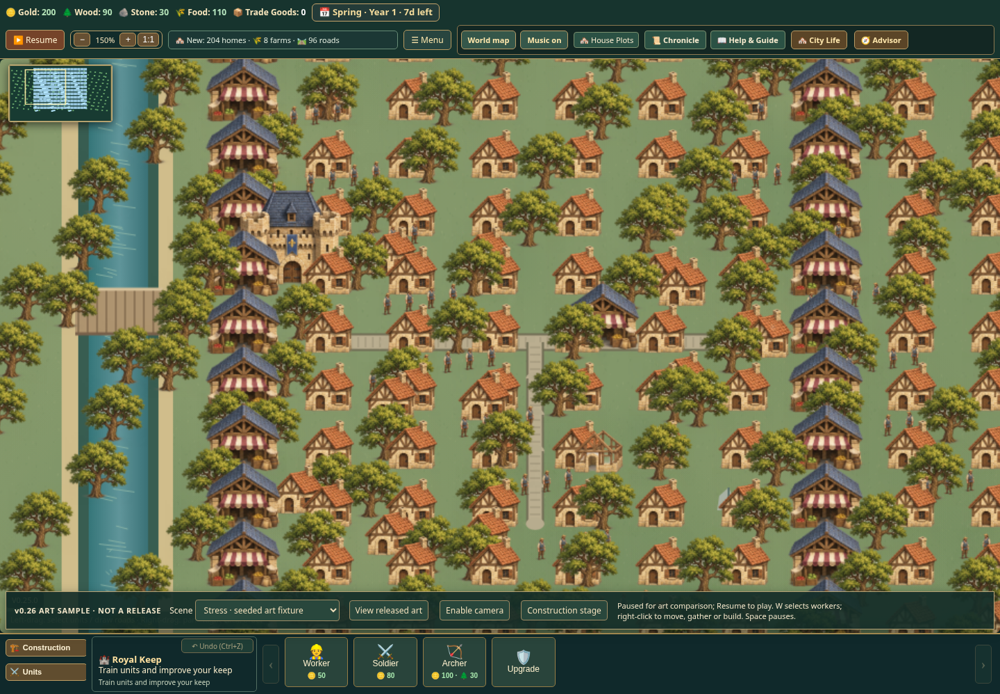

# v0.26 art sample — review gate

15 November 2026. Base: released v0.25 `f98d18764c35c4658a86a607531076bc01a78b2e`. **Throwaway playable sample, not v0.26 release delivery.** Full assets, workshop, agreements, loading yard and schema9 are pending sample review. No merge/deployment authorization.

## What to review
Original keep, cottage, Market, oak, worker poses and three construction stages run in the existing Canvas game. Rendering replaces the layered world draw for the sample; selection/orders remain an overlay. The released renderer remains available for a same-state comparison. Sprite origin/crops and SHA256 are recorded in samples/v026/assets/provenance.json and renderer.js. No pixels were copied from the concept image. The original PNG atlas is retained unchanged.

Normal Brookstead provides the opening state. The developed fixture contains30buildings,8resource nodes,3workers and1unfinished house. The deliberately crowded stress fixture contains222buildings,248nodes,120units and1worksite. These fixtures are seeded ART scenes, not funded progression or balance proof. Unsupported building types use labelled markers and nonworker/deposit art remains provisional. Sample roads/water/terrain are original cached drawing, not a complete production art pass. All starts/full asset coverage are later-stage requirements.

Every matched before/after pair has identical paused state, visual time, camera and150%zoom (scroll580,110),1440×1000viewport and DPR1. The game remains paused; only the dark Pause overlay and timed saying overlay are suppressed for both sides of this art review. The sample strip states that Pause is active. Screenshots are actual browser captures, without compositing or replacement scenery. The ordinary version badge remains v0.25 because the source simulation is unchanged.

| Scene | Released drawing | Sample drawing |
|---|---|---|
| Opening |  |  |
| Developed, seeded |  |  |
| Stress, seeded |  |  |

Construction: [foundation](../screenshots/v026-sample/construction-foundation.png), [frame](../screenshots/v026-sample/construction-frame.png), [roof](../screenshots/v026-sample/construction-roof.png). The sample's stage button sets fixture progress solely to inspect the art; ordinary construction still advances through real builders.

## Measurement
Reference: Intel Xeon Platinum8573C,3logical CPUs exposed; Linux6.18.57; Node24.19.0; Playwright1.57.0; explicitly selected system Chromium154.0.8037.57; headless ANGLE/Vulkan SwiftShader software renderer;1440×1000,DPR1,reduced motion. No second test browser ran during the retained measurement. This is not a physical-device performance claim.

Each case starts from the same fixture, warms for1second paused and1.5seconds running, then records6.5seconds of normal-clock operation. No accelerated tick loop. The released stress simulation advanced only~2.15game seconds during~8wall seconds because its existing frame-delta cap limits time under severe load; sample stress advanced~8.08. Consequently throughput/worker positions after timing are not claimed identical. Matched paused screenshots were verified separately by state/camera hashes, retained in the raw JSON.

| Scene / renderer | Mean fps | Frame ms p50 / p95 / p99 | Draw CPU ms p50 / p95 / p99 |
|---|---:|---|---|
| Opening / released |34.55|33.3 /33.4 /50.0|2.7 /4.1 /7.0|
| Opening / sample |60.00|16.7 /16.7 /16.8|0.5 /0.8 /1.4|
| Developed / released |34.16|33.3 /49.9 /66.6|4.4 /7.5 /16.7|
| Developed / sample |60.00|16.7 /16.7 /16.8|0.5 /0.8 /2.3|
| Stress / released |5.07|199.9 /233.3 /233.3|157.9 /184.2 /191.0|
| Stress / sample |32.77|33.3 /50.0 /50.1|1.6 /2.5 /4.5|

**Stress does not establish a sustained30fps minimum:** p95is50ms. Average rate exceeds30, but tail latency requires further work and budget agreement. Opening/developed target60fps on this reference only. Short sample runs are directional evidence, not long-duration stability proof.

Sample used JS heap at the end of opening/developed/stress:7.16/8.13/12.16MiB. Heap measurement excludes native decoded images, GPU and Canvas surfaces. The atlas decodes to6.00MiB, the sample's2450×900cached terrain to8.41MiB; comparison mode also retains the released terrain cache8.41MiB. Atlas PNG is2.13MiB. Full manifest records total uncompressed runtime bytes. Sprite draws are not claimed to be the only runtime cost: existing simulation/UI/ambient systems continue to run.

Proposed full-pass budgets for review: ordinary reference scenes near60fps with p95≤20ms; stress mean≥30fps with p95≤33.4ms; initial visual assets≤4MiBcompressed, eventual complete visual set≤12MiBcompressed, explicitly accounted decoded/cache surfaces≤64MiB. These are proposals, not yet owner-confirmed budgets. Current stress tail fails the proposed33.4ms budget.

## Validation and limits
- Existing visual baseline:7/7passed on exact released game source.
- Sample browser checks verify render purity and comparison state/camera in3scenes, native W selection, native gathering plus timber gain over5normal wall-clock seconds, native Market inspection, native Worksites assignment and progress after8normal wall-clock seconds, comparison/Escape, and missing-atlas fallback. They are repeatable via samples/v026/check.cjs; exact final results are recorded alongside the PR.
- No production index.html, release.json, prices, schema, shipments, receipts or chapter changes. Build refuses a root game differing from released v0.25 and validates the atlas digest/dimensions before packaging.
- Atlas failure returns to the released draw path. Rendering itself does not move workers, increment stages, produce or credit resources; sample fixture loading and the clearly labelled stage control are separate intentional state edits.
- The main new artwork is sprite-based; worker movement uses the existing engine. Four sample poses illustrate idle/walking/gather/build actions, not a complete directional animation set. No physical-device listening, other browser engines, mobile performance, full release regression or complete resource-funded v0.26 progression is claimed.
- The dedicated sample CI builds/checks/uploads the sample. The normal required verification pipeline remains separate. Final-head full CI, full assets and packaged release smoke are still final-release gates after the art review.

Raw measurements: [JSON](v026-art-sample-measurements.json). To review: inspect the matched pairs, play the downloadable archive or build the sample, then approve/revise the art direction and performance budgets before the full set is made.

Archive SHA256: `eedf731801bd1574938034cdd4eda839f9f9e6864e69b9c2b2b3a792ea1fb278`. Runtime payload:3,655,369bytes (~3.49MiB); ZIP:2469832bytes. All6runtime manifest entries were rehashed after extraction.

Final local sample checks:9/9PASS groups, zero uncaught game errors, including asset-failure fallback. Extracted archive smoke:9/9PASS with the same assertions. Initial native-selection probe read a stale legacy exposure and was corrected to inspect authoritative captured selection. An initial extracted-copy click ran before the sample camera reset; the test now waits two animation frames, with original interaction assertions/timeouts unchanged. The final extracted-copy rerun passed. Browser version and limits above apply; pinned-browser CI remains independent.
