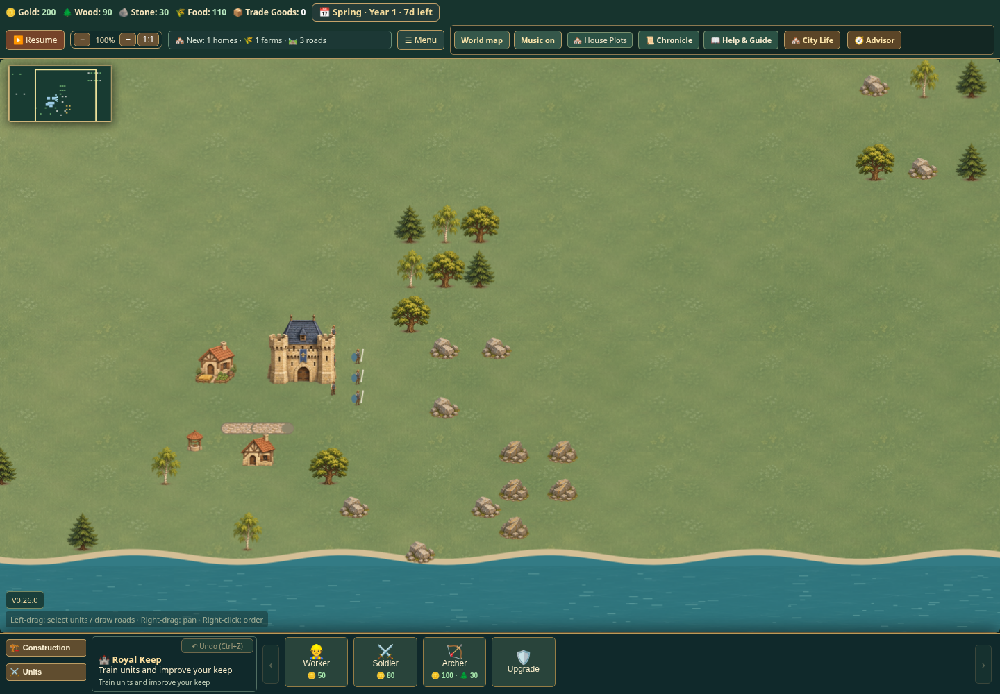
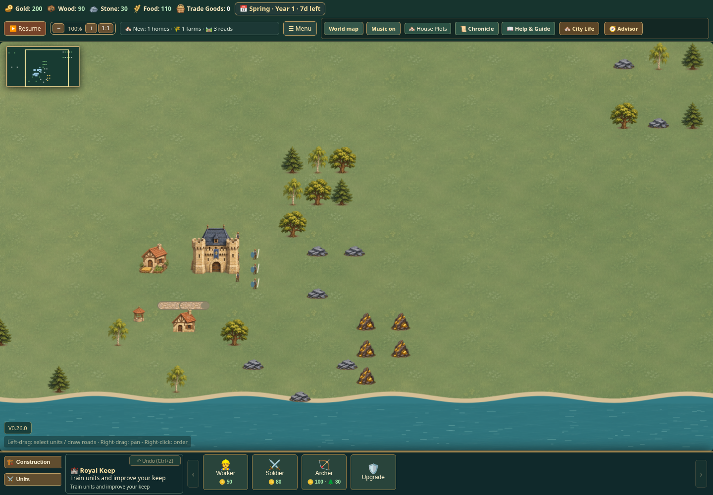
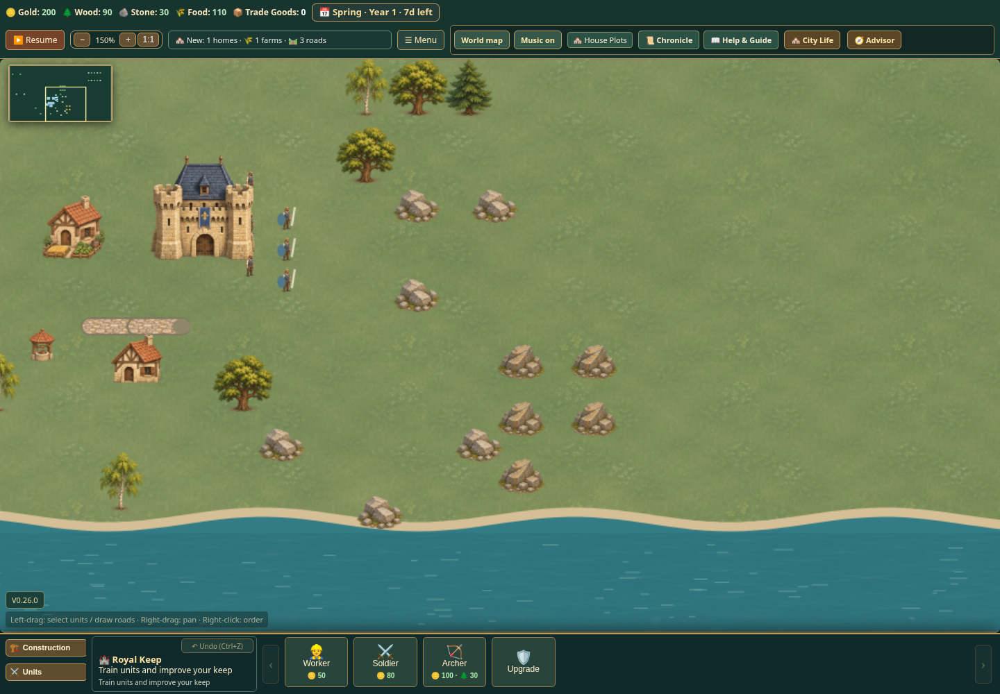
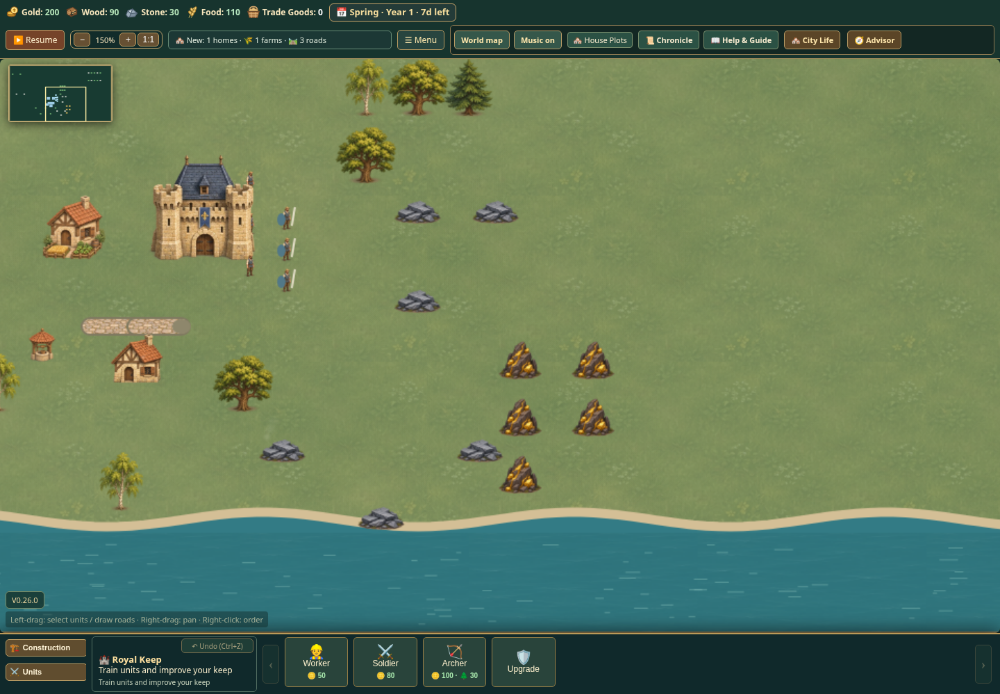
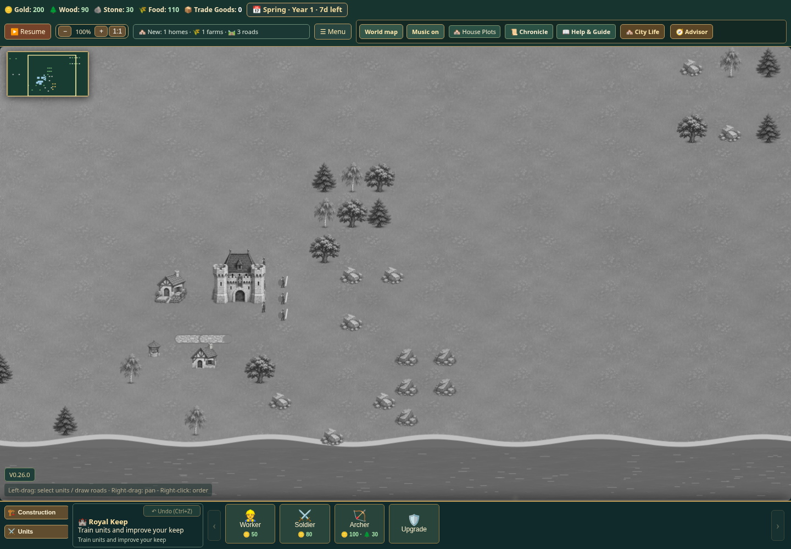
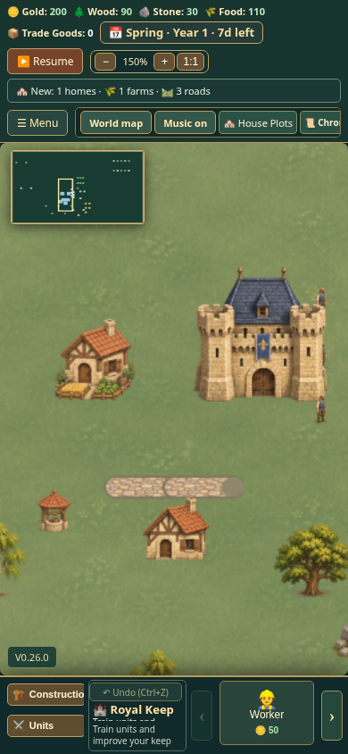
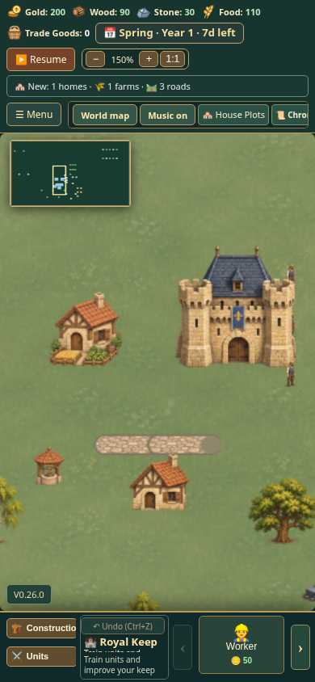

# v0.26 resource-readability follow-up

Owner approved the overall v0.26 gameplay and visual direction and requested this focused adjustment. Baseline: `fc83cd39de8da72f62e944e48dc3ef4df46242e5`. No merge or deployment is authorized.

## Changes

Stone now uses low, broad, cool-grey fractured slabs. Gold uses a taller dark ore formation with large warm metallic veins/nuggets. Their silhouette, surface pattern and palette differ at ordinary play scale. Node positions, radii, amounts, gathering and depletion rules are unchanged; depleted nodes keep their existing rubble art.

The top resource bar uses original inline SVG coins, timber logs, a faceted rock, grain and a filled basket, avoiding font-dependent emoji boxes. Names and live number elements remain visible, with descriptive tooltips. SVGs are decorative (`aria-hidden`) and do not add keyboard stops. Original number nodes and any tooltips/listeners on them are retained.

The new atlas adds **224,364 compressed runtime bytes** and **6,294,152 decoded pixel bytes**. Combined runtime art is 2,175,916 bytes; combined decoded atlases remain within the existing 24 MiB integrity budget. Existing art PNGs are unchanged. The release remains a three-file self-contained package.

## Matched comparisons

Actual Brookstead opening/deposits, without adding or relocating objects. Both versions use identical fresh-start initialization, paused simulation and frozen visual time. Only the comparison harness hides the Pause card and transient saying equally on both sides, so deposits remain visible. Identical simulation hashes, camera and zoom are checked; see [capture record](v026-resource-readability-captures.json). The display-only grayscale comparison checks the silhouette and surface separation as well as colour.

| View | Before | After |
|---|---|---|
| Normal 100% |  |  |
| Close 150% |  |  |
| Grayscale 100% |  |  |
| Narrow HUD |  |  |

Reproduce: `CHROMIUM_PATH=/usr/bin/chromium node scripts/capture-resource-readability.cjs`.

## Validation

The capture harness checks unchanged paused model state, identical camera/zoom, five labelled decorative resource graphics, tooltips and no browser exceptions. All **26/26 focused checks passed**. Existing focused checks cover locked assets, narrow/desktop HUD layouts, renderer state preservation, resource access/gathering, depletion and legacy restoration. The first comparison attempt used a save restore on only one side; unsaved cosmetic scenery differed, so that attempt was replaced by identical fresh-start initialization on both sides.

Full final-head CI, exact-source packaging and packaged smoke are release gates. Their final counts and the fresh verified artifact are recorded in PR #42 after completion. Previous v0.26 artifacts and CI do not verify this new head.
