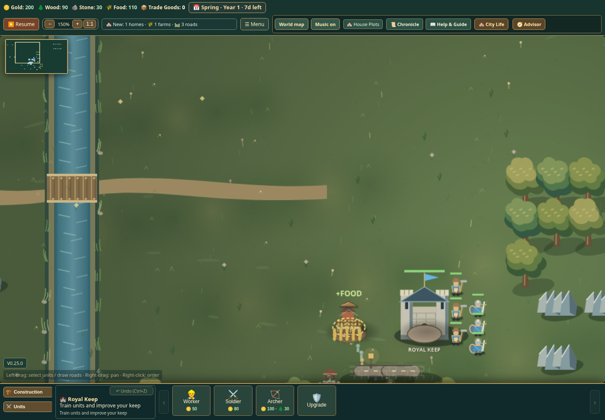
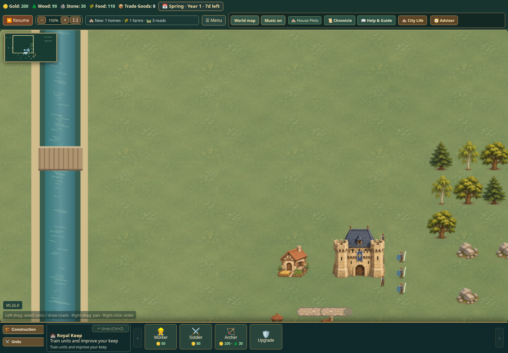
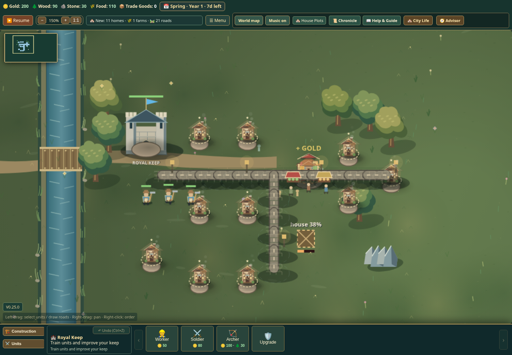
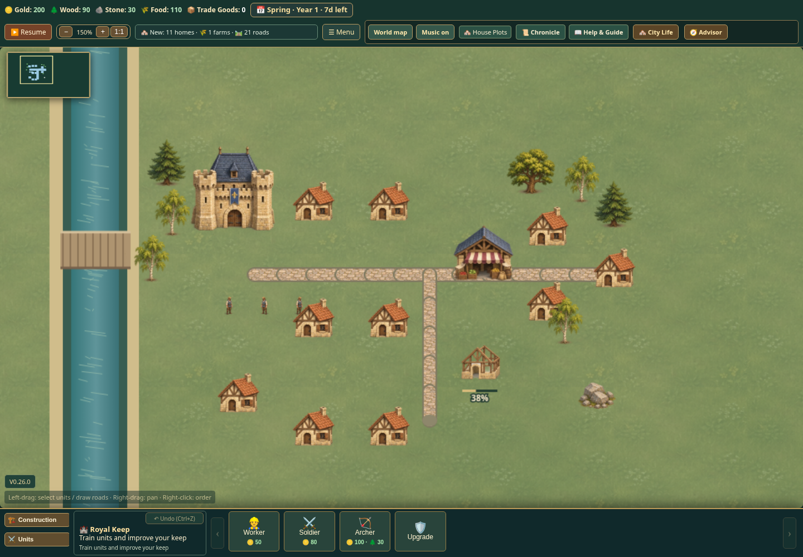
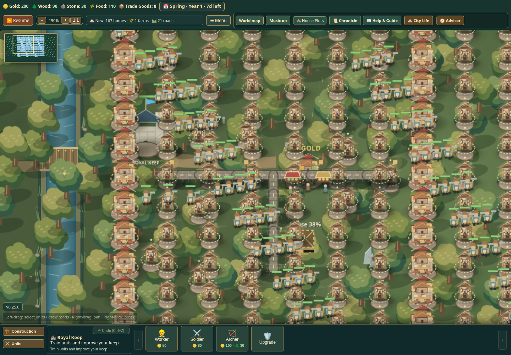
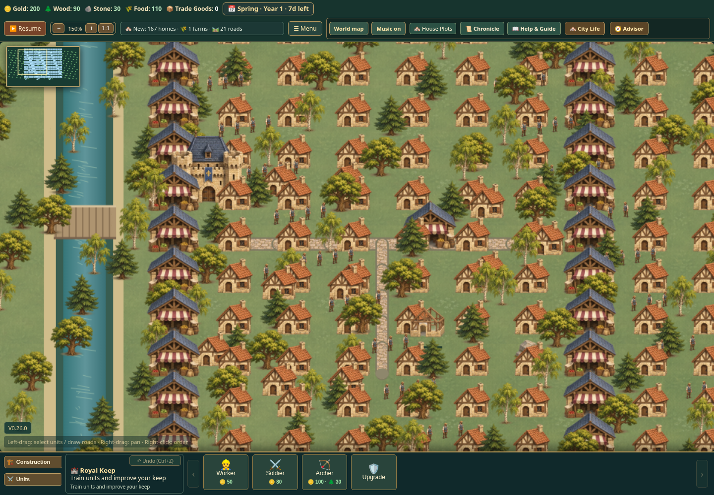

# v0.26 — A Working Trade Town validation

Candidate based on released v0.25 f98d187. Owner approved the playable sample and continuation on 15 November 2026. No merge, release dispatch, deployment or hosting change is authorized.

## Scope and economic evidence

The resource-funded route uses actual gathering, native paid construction, normal civilian production, real baskets, all three supplier agreements, a builder-funded loading yard and a manually dispatched standing order. It grants no resources, population or buildings. It saves/reloads the workshop, outbound/returning cargo and pending/completed yard. Its simulation is accelerated via the existing test helper; it is not a claim about wall-clock session length. See [funded route](v026-funded-route.json).

A separate normal-clock browser playtest loaded that legitimately funded city, used native Market → Neighbour trade to dispatch eight planks, and ran without a tick/advance adapter. The order returned 36 gold once after **121.256 wall seconds / 120.162 game seconds**. Timber was zero, and carpentry correctly produced no additional planks while food/basket production continued. [Normal-clock record](v026-normal-clock.json). Taxes and existing basket sales also earn gold; total treasury growth is not falsely attributed solely to the new reward.

Workshop staffing, pause/cap, reservation/sale exclusion, food/export policy, both mixed cargo choices, bounded batch costs, exact phase saves, refunds, undo, destroyed-yard rebuild, missing-yard dispatch rejection, atlas freeze, malformed saves and legacy fixtures are covered by the new engine/UI suites. Existing shipment/chapter terms remain unchanged. New state is strict schema 9; older saves do not receive invented progress.

## Actual visual comparisons

Every before/after pair below uses identical paused model state, visual time, viewport, camera and 150% zoom; state hashes are in the measurement JSON. Opening is the normal Brookstead start. Developed/stress are explicitly seeded art fixtures, not funded towns. The comparison-only harness hides the Pause darkening and timed sayings on both sides to inspect art. This CSS is not part of the production renderer.

| Scene | Released v0.25 | v0.26 candidate |
|---|---|---|
| Opening |  |  |
| Developed fixture |  |  |
| Stress fixture |  |  |

Construction: [foundation](../screenshots/v026/construction-foundation.png), [frame/walls](../screenshots/v026/construction-frame.png), [roof](../screenshots/v026/construction-roof.png). The fixture stages are explicitly set for art inspection; ordinary construction still requires real paid worksites and builders.

## Performance reference and limits

Intel Xeon Platinum 8573C, 3 logical CPUs exposed; Linux 6.18.57; Node 24.19.0; Playwright 1.57.0; explicitly selected system Chromium 154.0.8037.57; headless ANGLE/Vulkan **SwiftShader software rendering**; 1440×1000, DPR 1, reduced motion. One measurement browser ran, without a concurrent test browser. These measurements do not establish physical-device or other-engine performance.

For each source/scene, fresh navigation creates the same fixture, warms for one paused second and 1.5 running seconds, then records 6.5 running seconds. Matched screenshots are separately hashed while paused. The old stress renderer advances only 2.3 game seconds over the ~8 running wall seconds because the existing frame-delta cap limits simulation under heavy load; the new renderer advances ~7.93. Post-benchmark positions are therefore not claimed identical. No accelerated tick helper is used in timing runs.

| Scene / renderer | Mean fps | Frame ms p50 / p95 / p99 | Draw CPU ms p50 / p95 / p99 |
|---|---:|---|---|
| opening / released | 30.54 | 33.3 / 50.0 / 166.8 | 3.0 / 6.9 / 12.4 |
| opening / v026 | 59.23 | 16.7 / 16.7 / 16.8 | 0.8 / 1.6 / 2.8 |
| developed / released | 30.23 | 33.3 / 50.0 / 83.3 | 4.6 / 9.1 / 24.3 |
| developed / v026 | 59.69 | 16.7 / 16.8 / 16.8 | 0.8 / 1.4 / 2.4 |
| stress / released | 5.38 | 183.3 / 216.7 / 216.7 | 142.0 / 176.7 / 180.0 |
| stress / v026 | 37.48 | 33.3 / 33.4 / 50.0 | 2.7 / 4.7 / 5.9 |

The recorded ordinary scenes target 60 fps; the stress scene averages above 30 fps with p95 33.4 ms. **The p99 stress frame is 50 ms: this is not a promise that every frame sustains 30 fps.** Long-duration and physical-device performance remain unverified. Raw environment/counts/heap/frame data: [measurements](v026-measurements.json). Reproduce with `CHROMIUM_PATH=/usr/bin/chromium node scripts/measure-v026.cjs` after installing the locked dependencies.

Runtime visual assets total **1,951,552 bytes (1.86 MiB)**; original PNGs and runtime hashes are locked in [asset integrity](../../assets/v026/integrity.json). Decoded atlas pixels account for 18,870,092 bytes (18.00 MiB). Ground/road/sprite caches reach ~17.56 MiB on this reference, plus the main world canvas (~8.41 MiB): tracked new world surfaces/decoded art are ~44 MiB. The legacy loading/failure path can additionally retain an ~8.41 MiB ground canvas. This is explicit surface accounting, not a measurement of total native/GPU/browser-process memory. JS heap is reported separately in the raw JSON.

## Verification history and independent review

- Released visual baseline passed 7/7 before integration. The first production tests failed because the renderer/controller did not yet exist.
- Core feature checks and UI checks passed, then wider services testing exposed slow native input after a five-minute skirmish. A/B against legacy drawing and a CPU profile isolated native Canvas filter cost. Removing the per-enemy-unit filter preserved team colouring and made the unchanged services case pass. Sprite/road caching and runtime WebP encodings retain the original PNGs and dimensions.
- A destroyed-yard rebuild initially produced an invalid pending save; stale-link removal fixed it, with a regression. The funded route initially found an omitted Workshop pointer-placement mode; that was fixed without weakening paid-placement assertions. The route now plans a legal paired granary/bakery before paying, rather than assuming two independently found plots are within service range.
- The first comparison harness reused a page and carried one derived civic measurement cache into its expected snapshot. Fresh identical navigation fixed the harness; full state equality remains mandatory. Failed measurement runs are not counted as valid performance evidence.
- Independent read-only review found five P2 issues: Workshop placement overlay omission, missing health bars, missing enemy ownership cues, prerequisite journey chronology, and a reduced-motion target ring. Each was reproduced by a failing regression and fixed. A separate biome regression now retains all original ground palettes. No Critical finding or deferred minor was reported.
- Review declined to judge performance/device evidence, screenshot quality, crowded interaction acceptance, hidden-tab behavior, package smoke, full suite and final CI. Those remain the implementer's validation responsibilities; reference measurements, native/legacy tests and package/CI evidence must be read directly, rather than inferred from the source review.

- The first full regression attempt exposed an optional-presentation dependency: engine-only legacy caravan fixtures deliberately omit the older trade panel. The new supplier UI now checks that host before initializing, so engine-only tests do not throw. Shipment assertions were unchanged; the full suite is restarted on the corrected commit.

- The subsequent full run exposed a timing-dependent HUD assertion at 844×390: tooltip enrichment can change `House` to `Build housing for citizens` before the click. The saved trace confirms real House placement/cost feedback and a populated command notice. The layout test now waits for those actual signals; every clipping/overlap assertion remains unchanged.

## Release gates

This note records the implementation and local focused evidence before final integration finishes. **Full local regression, immutable-source package verification, packaged smoke and clean full final-head CI must all be confirmed in the PR's final validation update.** A green focused suite or the earlier sample is not a clean full-suite claim. The required verification workflow produces the three-file self-contained playable artifact only after all tests and packaged smoke pass. Its read-only PR jobs do not deploy.

The original art-sample ZIP remains a historical reviewed prototype, not the final v0.26 artifact. Use the final verified-site artifact linked from the PR after verification. All ordinary starts receive the renderer; prototype fixtures/controls are not included in the production payload. No full new mobile support, physical caravan, seamless travel, warfare expansion or multiplayer is claimed.
