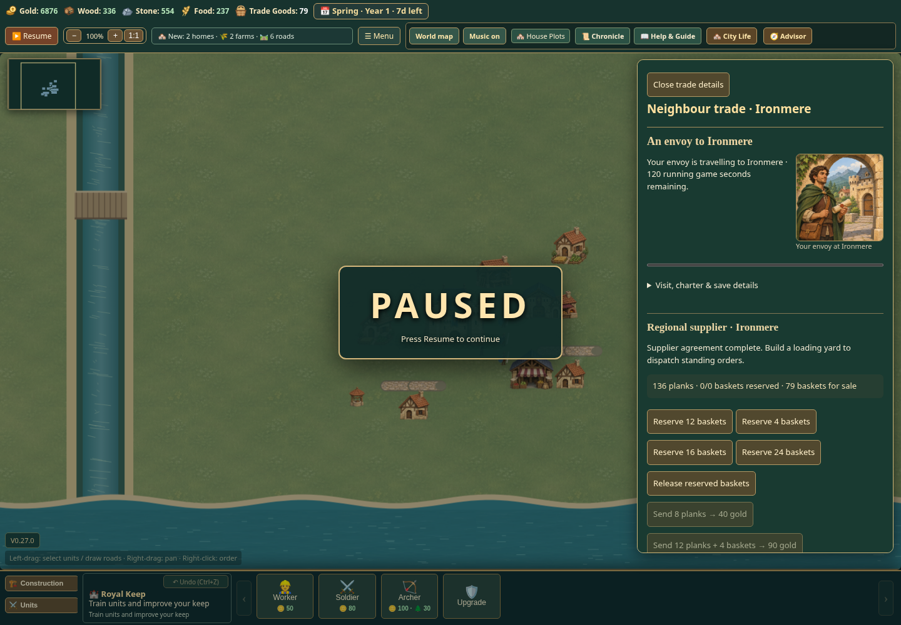
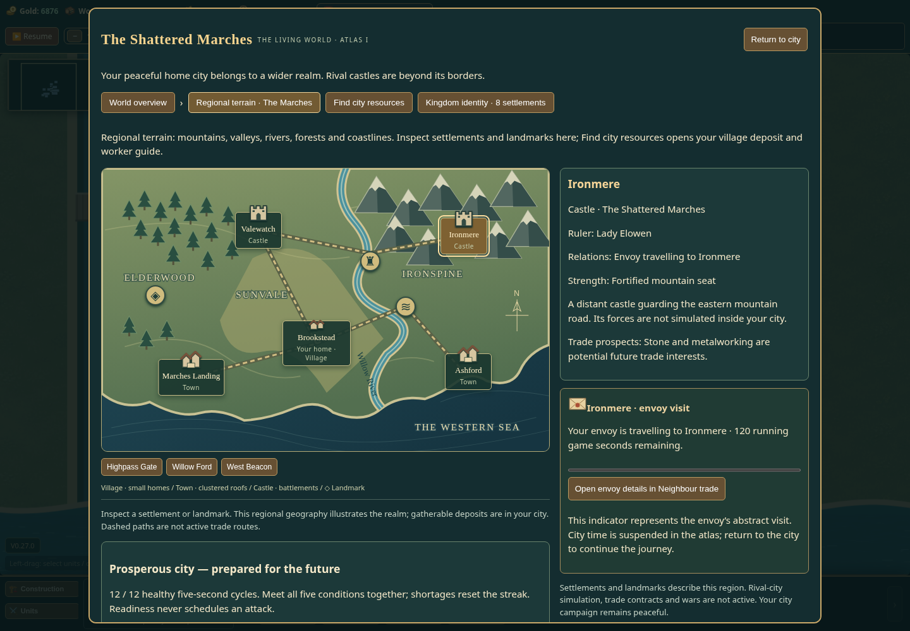
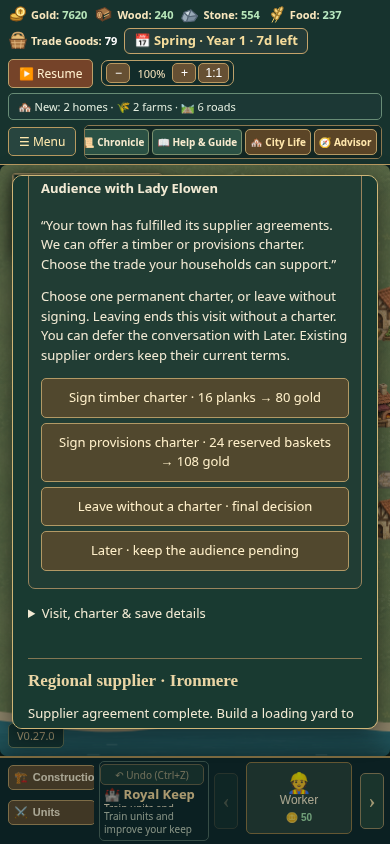

# v0.27 envoy validation history

Feature candidate; production remains v0.26. This file preserves implementation methods and initial validation history. Final-head results, normal-clock measurements and the verified playable package are maintained in [PR #43](https://github.com/GKoromilas01/Shattered-Crowns/pull/43). No merge/deployment approval is inferred.

## Methods and failures retained

- The first seven real-engine tests failed against the absent API, then passed with authoritative state and shared cargo. Existing supplier/caravan/save integration was 40/41: a genuine post-trade schema-9 fixture had been placed among historical no-regional-progress fixtures. It was moved into `tests/fixtures-envoy`; the unchanged legacy test then passed. No historical expectation was weakened.
- Initial native UI run: 4/8. Legacy trade-panel keyboard capture intercepted the new controls; its exclusion now delegates to the envoy epoch guard. Native hidden tabs previously advanced city time; the frame guard now freezes the simulation while hidden. Focused held-input/hidden recheck: 4/4.
- Combined art/engine/UI run: 16/17. Atlas status first exposed only an action-unavailable reason instead of the visit phase; it now explicitly states the unvisited phase. Final atlas recheck: 1/1. Other engine, capacity, UI and asset checks passed in that combined run.
- Initial funded run: 2/3, including the full timber charter route and unchanged original supplier route. Provisions failed in test navigation: the helper toggled an already open City Life panel closed before clicking its trade action. Corrected visibility-aware native navigation; a funded recheck is required.
- Independent fresh-context whole-branch review examined state validation, transactions, UI guards and exact embedding. It found an in-flight final-history-slot payment edge and a hidden post-decision focus destination. Both were regraded Important: their new regression tests failed, then passed after the fixes. The complete focused engine/UI/art suite passed 18/18. Pipeline unit checks passed 22/22. Browser scheduling, visual/performance judgments, full CI and package readiness were explicitly left to runtime evidence.

## Evidence distinctions

`tests/envoy.test.cjs` and UI tests use controlled town fixtures for boundary coverage. `tests/envoy-route.test.cjs` starts from a new town, gathers resources and pays for construction, workshops and the yard, completes existing agreements, then pays for the visit and consumes actual charter cargo. Its simulation time is accelerated explicitly; no resource/population/building grants count as funded proof.

`scripts/playtest-v027-normal.cjs` serves the production index unchanged and loads the genuine earned v0.26 supplier save. It uses native controls and normal browser time, with no tick adapter, fake clock or grants. Its output records wall time separately from game time. Treasury totals include normal tax and basket sales, so the charter reward is verified from the actual shipment record rather than attributing all gold growth to it.

The reference local environment is Node 24, Playwright 1.57.0 and explicitly selected system Chromium 154 on Linux. It is not the lockfile-pinned CI browser. Final CI must run the complete suite and package smoke on the immutable final head before readiness is claimed.

## Captured interface

These are actual native UI captures from controlled late-supplier fixtures, not claims that those test towns were resource-funded. Final CI evidence includes fresh final-head captures and separate funded route outputs.

## Owner access/opening amendment

The owner subsequently requested diplomacy from the beginning across all peaceful starts, clearer starting workers, illustrated command graphics, and removal of House Plots and replay interludes. These amend v0.27; they are not a new version.

The initial six opening/command checks failed against the old behavior; after moving workers, the Home entry check separately exposed the supplier-gated navigation. New global visit/strict stage-zero charter transactions and UI were implemented without inventing legacy progress. The first combined run was 22/24: an old assertion still expected the superseded entry gate, and one cold navigation exceeded an inherited seven-second action timeout before any game action. The gate assertion now checks early eligibility; navigation explicitly uses the existing harness convention of 30 seconds while action timeouts remain seven. The subsequent focused suite passed **36/36**: all five starts, both foreign early charter transactions, phase saves, cost/art graphics, native input guards, old supplier behavior and requested UI removals. Removal tests were observed failing before removing the controls.

The prior 507-test CI run verifies the earlier `eb13de4` candidate only. The amended final head requires fresh CI, which finishes independently; no automatic polling or blanket claim that old CI verifies new code. A fresh reviewer was attempted but could not start because of an agent usage limit; this amendment receives explicit author review plus runtime checks, with that limitation recorded for owner review.

Additional checks: **9/9** passed for the original supplier engine plus the mixed chronology where an early charter precedes the old shipments and supplier agreements. Screenshot inspection then caught old trade requirements appearing above the envoy. A native ordering assertion failed, the envoy was moved directly below the panel heading and unavailable old requests were put behind a disclosure; the ordering check passed **1/1**. Before/after captures use the previous candidate and the amended native game at the same viewport.

[Opening before](v027/access/opening-before.png) · [Opening after](v027/access/opening-after.png) · [Commands before](v027/access/commands-before.png) · [Commands after](v027/access/commands-after.png) · [Early diplomacy](v027/access/early-diplomacy.png).

## Baseline CI follow-up before v0.28

The amended v0.27 full CI completed507/516, with nine failures. Three trade checks lost their recognizable Neighbour trade/offer status after the button label was simplified; the label now retains Diplomacy plus the actual available offer status. The old unavailable-route test is updated to check that diplomacy is available and the optional older route still explains its unmet requirements. Four defense checks used a fixed plot within180units of the old worker spawn but outside the new front-of-Keep formation; the successful-placement fixtures now choose a plot relative to the actual worker, preserving the unchanged180-unit rule, costs, selection and undo assertions. One narrow planning check raced a periodic DOM replacement between focus and a later bounding-box call; its focus/containment measurement is now atomic while retaining update-survival checks.

These failures were reproduced before fixing. The focused eleven-case recheck passed11/11 on explicitly selected Chromium143.0.7499.0 (distinct from CI143.0.7499.4). One intermediate new test selector matched two nested summaries and was corrected to the direct summary. Fresh full CI runs independently; the earlier failed run is retained as validation history. This is a v0.27 baseline repair, not a new release or deployment.
